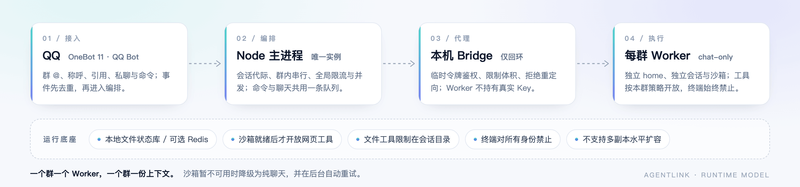

# 架构与开发

AgentLink 是 AlemonJS 的一个插件：QQ 事件在 Node 主进程里编排，模型能力由本机 DSH Worker 提供。一个进程、一个机器人、每个群一份独立上下文。



## 一条群消息的旅程

1. **接入**：OneBot 11 或 QQ Bot 推送消息事件；校验平台、账号、发送方向与自身消息回显。
2. **归属**：读取发言人、引用、合并转发的可访问部分；附件只带类型，不伪装成已读内容。
3. **分段**：普通群聊等待 1.2 秒聚合，持续发言最多等 4 秒；`/chat` 不主动等待。
4. **判断**：明确 @、引用机器人、句首直接称呼直接进入；其余称呼、关键词与普通消息由独立 `replyGate` 判断两件事——是不是在喊它（`addressed`）、是不是接着它的上下文（`related`），再在静默时段、冷却、突发上限、防循环处裁决。
5. **排队**：同群串行，单群最多 3 个等待请求；全局最多 8 个并发、16 个 Worker。
6. **组装**：人格、心情、长期记忆、近期参考与工具策略组成这一轮的上下文；预算在请求边界检查。
7. **执行**：Worker 通过带临时令牌的本机 Bridge 调用模型；模型可调用模块业务工具，沙箱工具仍在 Worker 内执行。
8. **发送**：回复分条成 QQ 气泡，按打字间隔发出；拿到成功回执后才确认去重、写归档与引用索引。

命令与聊天共用这条队列，但命令不写对话记忆、不计入普通群接话计数，也不增加新的模型调用。

## 模块地图

| 目录                                  | 职责                                                    |
| ------------------------------------- | ------------------------------------------------------- |
| `src/index.ts`                        | 插件入口：启动清理、配置监听、DSH 预热、定时任务        |
| `src/router.ts`                       | 全部命令注册与事件分流（命令 / @ / 普通讨论 / 私聊）    |
| `src/response/`                       | 每条命令与入口的回复实现，统一使用气泡格式              |
| `src/social/`                         | 群分段、参与策略、回复判断、引用、防循环、群管理        |
| `src/dsh/`                            | 会话编排、Bridge 客户端、模型与人格、记忆注入、输出切分 |
| `src/agent/`                          | 模块加载、工具轮次、工具权限与续跑                      |
| `src/memory/`                         | 长期记忆、检索、自动整理与来源核对                      |
| `src/qa/`                             | 问答库存储、问因识别、匹配排序与内置条目                |
| `src/companion/`                      | 人格文件、心情、自动语音与表情                          |
| `src/media/`                          | 图片/语音/表情的下载、识别、工坊与本地面板              |
| `src/model-pool/`、`src/credentials/` | 端点池、多 Key 轮转、余额与探活                         |
| `src/billing/`                        | 每日额度、账本与主人调整                                |
| `src/state/`、`src/history/`          | 状态库（本地文件或 Redis）、会话代际、聊天归档          |
| `src/platform/`、`src/onebot/`        | 平台能力抽象、OneBot 传输、戳一戳、群管理               |
| `src/modules/`                        | 内置模块与外部插件的 Expose 能力发现                    |
| `src/qzone/`、`src/bili/`             | QQ 空间与 B 站的可选业务能力                            |
| `runtime/`、`python/`                 | 启动器、诊断、进程锁与 DSH Python 桥接                  |
| `test/`、`scripts/`                   | Node 与 Python 回归、发布检查脚本                       |

## 状态与一致性

- 默认使用本地文件状态库；检测到框架 `db.redis` 配置时继续使用 Redis。两种后端都承担去重、限流、会话代际与主人键。
- 重置与彻底删除先写入过渡状态，再操作 Worker 数据；进程或状态库中途失败时，下次访问会安全续作，而不是把旧会话指向已删除的历史。
- 群聊分段、引用索引、防循环记录是有界进程内状态，重启后不恢复；正式对话、长期记忆和归档不受影响。

## 关键约束

| 约束                      | 原因                                                             |
| ------------------------- | ---------------------------------------------------------------- |
| 只允许一个 Node 进程      | 缺少 Redis 分布式租约，多副本会破坏群内顺序、取消与首次隔离迁移  |
| Worker 不持有真实 API Key | 只能通过本机 Bridge 的临时令牌访问模型，代理限制体积、拒绝重定向 |
| 终端对所有身份禁止        | 策略命令不能重新开启；DSH 原生终端与后台作业固定关闭             |
| 文件工具限制在会话目录    | 只接受相对路径，拒绝穿越、绝对路径、符号链接与硬链接             |
| 沙箱不可用时降级纯聊天    | 网页工具暂不可用，后台按 30 秒至 5 分钟退避重试                  |

## 本地开发

```bash
npm install
npm run build
npm start          # 运行构建产物
npm run dev        # 热重载开发
npm test           # 构建 + ESLint + Node/Python 回归
npm run doctor     # 离线检查配置与运行环境
```

开发时注意：热重载可能在旧 Gateway 连接尚未释放时建立第二个连接，导致网关重置；生产环境不要频繁热重载。

## 相关文档

- [配置指南](config.md) · [配置字段参考](config-reference.md)
- [模块与业务工具](modules.md) · [人格、心情与自动表达](companion.md)
- [安全与数据](security.md) · [运维手册](operations.md)
- [能力建设与验收](capabilities.md)

---

[← 文档首页](README.md) · [项目主页](../README.md) · [命令速查](commands.md)
